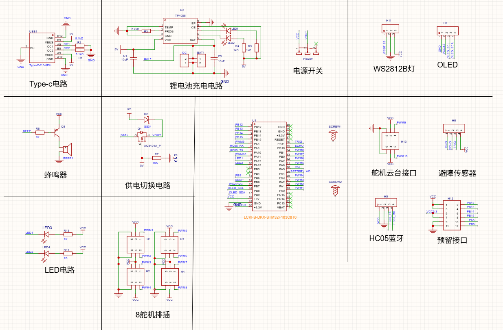
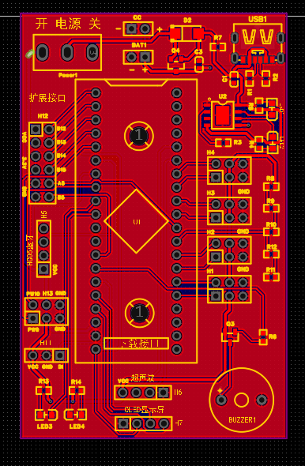

# STM32 四足机器人

## 每日进度日志

- **2026年11月16日**：成功 Fork 并 Clone 项目，深入阅读了 main.c 核心步态控制逻辑，由 AI 辅助添加了全量中文注释，并尝试修改了步态速度与抬腿高度参数（已同步至云端）。随后在 Keil 中按 F7 首次编译通过：**0 Error(s), 0 Warning(s)**，并成功生成 `.hex` 文件。下一步计划：烧录固件，架空机身实测新的步态速度与抬腿高度。

## 项目来源与贡献

- 原项目作者：**我的STM 32又烧了**
- 本开源版本：由贡献者在原项目基础上完成步态、串口稳定性、舵机保护与工程结构优化，并整理为可公开复用的软硬件资料包。

请勿把本仓库理解为抹去原作者的重新署名版本；原项目贡献始终归属于“我的STM 32又烧了”，后续优化归相应贡献者所有。

这是一个以 STM32F103C8T6 为控制核心的四足机器人开源资料包，包含精简后的 Keil 固件工程、嘉立创 EDA 工程、Gerber 制板文件、原理图预览和基础物料清单。

本版本在原项目基础上重点优化了非阻塞步态状态机、前进/后退参数与左右修偏、串口收包边界与异常恢复、舵机角度钳位，以及 WS2812 DMA 超时后的安全收尾。

## 硬件预览

| 原理图 | PCB |
| --- | --- |
|  |  |

本次公开文档只把以下三个动作作为核心功能：

- 前进：蓝牙发送 `@UP#*`
- 后退：蓝牙发送 `@BACK#*`
- 抬腿/恢复站立：蓝牙发送 `@TJ#*`

源码中还保留了一些辅助动作和外设示例，但它们不作为本项目的主要功能承诺。机器人实际运行前请先架空机身，确认舵机方向、机械限位、供电和共地连接正确。

## 目录

- `firmware/Keil/`：STM32F103C8T6 的 uVision 工程和源码。工程已打开 HEX 输出选项。
- `hardware/easyeda/`：嘉立创 EDA 工程。
- `hardware/manufacturing/`：Gerber 与钻孔制造文件。
- `hardware/images/`：原理图和 PCB 预览图。
- `hardware/BOM.md`：去除推广内容后的基础物料清单。
- `docs/BLUETOOTH.md`：HC-05 和兼容手机控制器的连接与指令说明。
- `docs/EXTENSIONS.md`：可扩展接口和超声波集成边界。
- `THIRD_PARTY_NOTICES.md`：第三方代码和资源的版权/许可边界。

## 构建

工程面向 STM32F103C8T6，使用 Keil MDK/uVision 5、ARM Compiler 5 和 STM32F10x Standard Peripheral Library。打开 `firmware/Keil/Project.uvprojx` 后执行 Rebuild；当前环境未附带 Keil，因此本仓库不会伪造“已编译通过”的声明。

公开工程故意不包含 `Objects/`、`Listings/`、本机 IDE 状态文件和构建日志。若使用不同版本的 Keil 或启动文件，请先确认时钟、Flash/RAM 配置和舵机 PWM 输出。

## 许可证

原作者及贡献者有权授权的代码、文档和硬件设计资料按 MIT License 发布，详见 [`LICENSE`](LICENSE)。STM32 官方库、CMSIS 和其他第三方内容不自动继承 MIT，详见 [`THIRD_PARTY_NOTICES.md`](THIRD_PARTY_NOTICES.md)。

## 蓝牙应用说明

本项目兼容第三方应用 **Arduino bluetooth controller**（包名 `com.giumig.apps.bluetoothserialmonitor`，版本 1.3）。该应用不包含在本仓库中，也不受本项目 MIT License 覆盖；请从你有权使用的官方来源获取。已审查的参考 APK SHA-256 为：

`8E6A217664655713485AB4B0FB880E5CC4C3CBBC2B0BA25837BB42F39D62E7E0`

## 作者署名

如转载、修改或制作衍生版本，请保留原项目作者署名“我的STM 32又烧了”、贡献说明及对应许可证/第三方声明。
